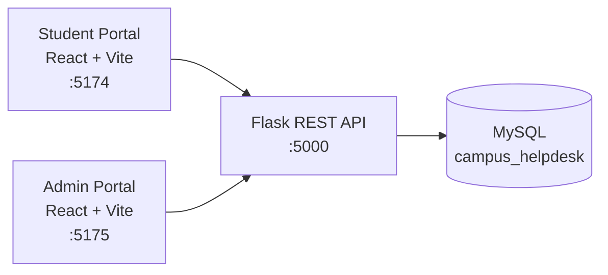

# CampusHelpDesk

A full-stack campus complaint management platform with separate Student and Admin portals, a Flask REST API, and a MySQL database.

> CampusHelpDesk is an independent project. It is separate from the author's CircuitWeb and EduLabX repositories.

## Project at a glance

| Component | Technology | Local address |
|---|---|---|
| Student Portal | React, Vite | http://localhost:5174 |
| Admin Portal | React, Vite | http://localhost:5175 |
| Backend API | Python, Flask | http://127.0.0.1:5000 |
| Database | MySQL | `campus_helpdesk` |

## Capabilities

The supplied application source and project documentation describe these capabilities:

- Student account registration and login using college roll numbers.
- Student complaint submission and private complaint tracking.
- Student notifications and complaint status history.
- Admin complaint listing, searching, filtering, and detail views.
- Admin status and priority updates.
- Admin analytics and overview metrics.
- Complaint assistance that suggests categories, priorities, and departments and can identify similar complaints. These suggestions are advisory; they are not an autonomous decision system.
- JWT-based authentication for protected API routes.
- Database migration and integrity-check scripts.

Feature availability depends on the database schema and migrations installed in the local environment.

## Architecture



The two frontends are separate Vite applications. They communicate with the Flask API, which reads and writes application data in MySQL.

## Repository layout

```text
CampusHelpDesk/
├── backend/
│   ├── app.py
│   ├── complaint_ai.py
│   ├── requirements.txt
│   ├── migrations/
│   └── ...database setup and test scripts
├── frontend/          # Student portal
│   ├── src/
│   └── package.json
├── admin-frontend/    # Admin portal
│   ├── src/
│   └── package.json
├── start.sh
├── stop.sh
├── upgrade.sh
├── DATABASE_UPGRADE.md
└── START-HERE-TWO-HOSTS.txt
```

## Requirements

- Ubuntu or another Linux environment
- Python 3
- Node.js and pnpm
- MySQL Server
- Git

Use compatible versions for the packages in the supplied lockfiles and requirements file.

## Local setup

1. Extract this repository.
2. Create and configure the backend environment file:

   ```bash
   cd CampusHelpDesk
   cp backend/.env.example backend/.env
   ```

3. Edit `backend/.env` with your own MySQL host, user, password, database name, and a strong JWT secret. Never commit this file.
4. Review `DATABASE_UPGRADE.md` before running migrations. Back up any existing database first.
5. Install backend dependencies and apply migrations:

   ```bash
   cd backend
   python3 -m venv venv
   source venv/bin/activate
   pip install -r requirements.txt
   python apply_migrations.py
   python check_database.py
   cd ..
   ```

6. Install frontend dependencies in each frontend directory:

   ```bash
   cd frontend && pnpm install && pnpm run build
   cd ../admin-frontend && pnpm install && pnpm run build
   cd ..
   ```

7. Start the services using the supplied start script:

   ```bash
   ./start.sh
   ```

8. Open the Student Portal at `http://localhost:5174` and the Admin Portal at `http://localhost:5175`.

Consult `START-HERE-TWO-HOSTS.txt`, `DATABASE_UPGRADE.md`, and the phase-specific project notes for additional setup and upgrade instructions. If the script requires execute permission, run `chmod +x start.sh stop.sh upgrade.sh`.

## Configuration and security

- `backend/.env.example` is a template. Copy it to `backend/.env` and set local values.
- Do not publish `.env` files, database exports, real user data, JWT secrets, passwords, runtime logs, or local virtual environments.
- The public source archive intentionally excludes local credentials, database backups, runtime state, dependency folders, and generated build output.
- Change development credentials before deploying beyond localhost.
- Review authentication, authorization, CORS, and database settings before any production deployment.

## Database migrations

SQL migrations are stored in `backend/migrations/`. Read `DATABASE_UPGRADE.md` before applying them to an existing database. The migration scripts are intended to evolve the schema; always keep a separate database backup before making changes.

## Testing and checks

The backend folder includes smoke/login/complaint-assistance test scripts and a database check script. Run them only after configuring a test database and environment. Do not run destructive or upgrade operations against production data without a verified backup.

## Release

Release tag: `v1.0.0`

This release ZIP contains the application source and setup documentation. It does not contain installed dependencies or a populated database. Follow the setup instructions to install dependencies and configure your own database.

## Author

**Prabhjot Singh**  
GitHub: https://github.com/1231248393
